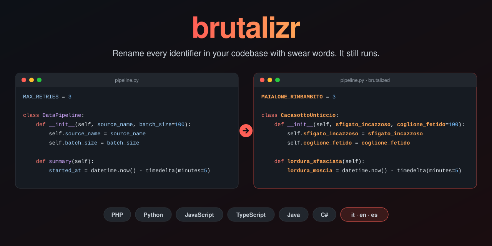

# brutalizr

<p align="center">
  
</p>

<p align="center">
  <a href="https://github.com/simonecosci/brutalizr/actions/workflows/ci.yml"></a>
  
  <a href="LICENSE"></a>
  <a href="#docker"></a>
  
  
  
  <a href="https://github.com/simonecosci/brutalizr/commits/main"></a>
</p>

Takes a project's source folder and renames variables, functions, methods, constants,
classes, interfaces, enums and parameters with swear words. The code becomes offensive
to read but, as far as possible, **it stays the same program**: every name is replaced
with the same swear word across all files, and anything that belongs to external
libraries is left alone.

Languages: **PHP, Python, JavaScript, TypeScript (including .tsx), Java, C#**.

```php
class CazzataFlaccida
{
    private int $scorreggioneSfasciato = 3;
    const COGLIONE_SBROCCATO = 'viewer';

    public function belinRincoglionitoSmerdato(array $monaInchiappettata, int $cazzataCagata = 10): array
    {
        $leccaculoFottuto = [];
        foreach ($monaInchiappettata as $minchiaLurida => $cacasottoSbroccato) {
            $leccaculoFottuto[] = "$minchiaLurida={$cacasottoSbroccato}";
        }
        Log::info("found " . count($leccaculoFottuto));
        ...
```

## Installation

```bash
pipx install ./brutalizr        # or: pip install ./brutalizr
```

Requires Python ≥ 3.10. Language grammars ship with `tree-sitter-language-pack`,
nothing else to install.

## Docker

No Python needed: build the image once, then mount the folder that contains your project
on `/work`. Paths given to `brutalizr` are relative to that folder.

```bash
git clone https://github.com/simonecosci/brutalizr.git
docker build -t brutalizr ./brutalizr

# from the folder that contains my-project → writes ./my-project-brutalized
docker run --rm -v "$PWD:/work" brutalizr my-project -l en

# keep host file ownership on Linux/macOS
docker run --rm -u "$(id -u):$(id -g)" -v "$PWD:/work" brutalizr my-project

# dry run, full map
docker run --rm -v "$PWD:/work" brutalizr my-project -n -v
```

PowerShell: use `-v "${PWD}:/work"`. `--in-place` asks for confirmation, so add `-it`
(or pass `-y`). Without arguments the container prints the help.

## Usage

```bash
brutalizr ./my-project                    # writes to ./my-project-brutalized
brutalizr ./my-project -o /tmp/filth      # custom destination
brutalizr ./my-project -l en              # English swear words (it, en, es, fr, de, nap, mix)
brutalizr ./my-project -s 42              # same names on every run
brutalizr ./my-project -n -v              # dry run: show the map, write nothing
brutalizr ./my-project --in-place         # overwrite the sources (asks for confirmation)
```

Useful options:

| Option | What it does |
|---|---|
| `-k name1,name2` / `--keep-file f.txt` | names never to touch |
| `-x folder` | exclude more folders (besides `vendor`, `node_modules`, `.git`, `dist`, `build`, `storage`, `venv`…) |
| `--dump-map map.json` | save the map `{family: {name: swear_word}}` |
| `--use-map map.json --reverse` | restore the original names from a brutalized output |
| `--no-rename-files` | do not rename Java/PHP files named after their class |

To go back:

```bash
brutalizr src -o src-brutal --dump-map map.json
brutalizr src-brutal -o src-restored --use-map map.json --reverse   # byte-for-byte identical
```

## How it works

It uses tree-sitter to get the real syntax tree of every file (no regex), so strings
and comments are never touched. Two passes over the whole project:

1. **Collection.** Finds the names *declared* in the project (classes, functions, methods,
   properties, constants, variables, parameters, enum values) and tells class members
   apart from local variables. It also records names coming from external libraries
   (`import`, `use`, `require` of non-local packages).
2. **Replacement.** Every occurrence of a declared name becomes its swear word, which
   keeps the original style: `camelCase`, `PascalCase`, `snake_case`, `UPPER_SNAKE`,
   `_`/`$`/`#` prefixes. Adjectives agree with the noun's gender (`minchiaLurida`,
   `poubelleVisqueuse`, `VersiffterArsch`, `BloedeSau`, `RanzigesArschloch`).

Vocabularies: Italian (`it`, default), English (`en`), Spanish (`es`), French (`fr`),
German (`de`), Neapolitan (`nap`), or all of them shuffled (`mix`).

The vocabularies hold hundreds of nouns and adjectives per language (tens of thousands
of two-word combinations, millions with three), so even projects with thousands of
identifiers get unique names; when short combinations run out, longer phrases are used.

Things that are never renamed:

- anything imported from external packages, and members of external objects
  (`np.array`, `Log::info`, `console.log`, `System.out`);
- language builtins and globals (`len`, `print`, `Math`, `JSON`, `String`…);
- base type methods (`dict.items`, `Array.push`, `List.add`, LINQ…) when the project
  declares a member with the same name; as local variables they get brutalized instead;
- framework "conventional" names: magic methods `__x__`, `self`/`this`, Angular
  lifecycle (`ngOnInit`…), Laravel (`handle`, `boot`, `up`/`down`, `$fillable`, `$table`,
  `$casts`, `scopeXxx`, `getXxxAttribute`…), Airflow (`execute`, `template_fields`…),
  `main`/`Main`, `toString`/`ToString`, standard Java and C# overrides;
- module names in Python imports (they map to files);
- PHP/C# namespace names and Java package names.

Each language has its own namespace (Python, PHP, JS/TS, Java, C#): an `items`
declared in the TypeScript frontend does not touch `.items()` in the Python backend.

## Limitations (honest ones)

There is no type analysis, so some things may break at runtime:

- **dynamic access by name**: reflection, `getattr(obj, "name")`, `$obj->$var`,
  JSON/ORM serialization relying on property names, C extensions reading attributes
  by name, database fields in Laravel (`$user->role`);
- **name-based conventions**: Laravel factories resolved by class name,
  `Controller@method` routes written in strings, Angular/Blade templates (`.html`,
  `.blade.php` are not rewritten), autoloading that does not follow PSR-4;
- a name the project declares that an external object also uses as a member, when
  the object cannot be recognized as external (e.g. a value returned by a library);
- the public API gets renamed: users of a brutalized library must use the new
  names (that's what the `--dump-map` map is for).

Great for reading and laughing; for running, a smoke test is a good idea.

## Tests

```bash
python3 tests/check.py
```

Brutalizes the sample sources in `tests/fixtures` (one per language) with every
vocabulary and three seeds, runs both original and result (`python3`, `node`,
`tsc --strict`, `php`, `javac`/`java`; syntax check only for C#) and checks that the
output is identical and that `--reverse` restores the sources byte for byte.

## Contributing

Issues and pull requests are welcome: see [CONTRIBUTING.md](CONTRIBUTING.md).

## License

[MIT](LICENSE) © Simone Cosci
